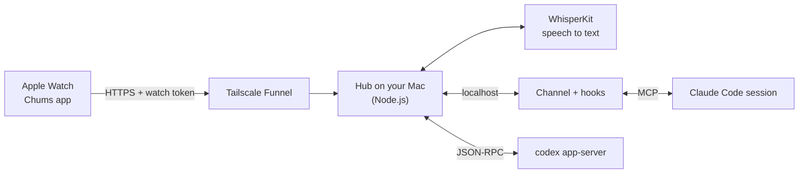

<p align="center">
  <picture>
    <source media="(prefers-color-scheme: dark)" srcset="docs/media/readme/wordmark-light.svg">
    
  </picture>
</p>

<h3 align="center">The AI you already use. Now on your keychain, your backpack or your wrist.</h3>

<p align="center">
  Chums puts the Claude Code and Codex already running on your Mac on an Apple Watch and an iPhone.<br>
  Hold the screen, say what you want, let go. Each agent is a character that acts out what it's doing.
</p>

<p align="center">
  
</p>

<p align="center">
  <a href="https://chums.club"><b>chums.club</b></a> ·
  <a href="docs/setup.md">Setup</a> ·
  <a href="docs/troubleshooting.md">Troubleshooting</a> ·
  <a href="docs/architecture.md">How it works</a> ·
  <a href="docs/characters.md">Characters</a> ·
  <a href="CONTRIBUTING.md">Contributing</a>
</p>

<table>
  <tr>
    <td width="33%" valign="top"><b>No new model</b><br>Your agents run on Claude Code or Codex, on your Mac.</td>
    <td width="33%" valign="top"><b>No new subscription</b><br>Chums is free and open source. The AI subscription you already have does the work.</td>
    <td width="33%" valign="top"><b>No Chums account</b><br>No Chums login. The watch and the iPhone talk to the hub on your own Mac.</td>
  </tr>
</table>

Everyone is building a cute new assistant: another subscription, another app, another company holding your data.
Chums is a team of agents on the AI you already pay for.

Each agent runs on Claude Code or Codex, picked per agent from the watch or the iPhone:
[docs/other-agents.md](docs/other-agents.md).

**What you need:** an Apple Watch on watchOS 10 or later and the iPhone it is paired with (iOS 26 or later),
a Mac with Apple silicon and Xcode 26, an Apple ID (a free one works), a free Tailscale account, and Claude Code or Codex. You build the apps
from source and run the hub on your Mac. The first setup takes 20–30 minutes, plus up to half an hour of waiting for
Xcode to prepare the watch and for a new Funnel address to reach public DNS. [Requirements](#requirements) ·
[Quickstart](#quickstart) · [Set it up with your agent](#set-it-up-with-your-agent)

## Set it up with your agent

Chums is source code, not an App Store download. Paste this into Claude Code or Codex on your Mac. It does the setup
and stops when it needs your hands: signing in, plugging in your iPhone, turning on Developer Mode.

```text
Set up Chums for me: clone https://github.com/lcoutodemos/chums and follow its AGENTS.md.
```

## What you can do from the watch


- **Talk to an agent.** Hold the screen, say what you want, let go. The Mac transcribes it and sends it to the agent.
- **See what it is doing.** The character acts out the agent's state: listening, thinking, working, waiting for you,
  done, blocked. Each tool call appears on screen as it runs.
- **Approve or deny actions.** When the agent asks for permission, hold the card to allow it or tap × to deny it.
- **Hear short replies.** The agent answers in one short sentence, spoken on the watch in the character's own voice (with the voices installed),
  and kept in a conversation you can scroll.
- **Get pictures.** Ask for a screenshot of your screen, an app or a web page, or for something the agent made; it
  arrives as a picture you can zoom.
- **Switch between agents.** Each agent is its own session and character. Tap the faces at the top left to pick one;
  what you say goes to the one on screen. Another agent's news arrives as a haptic tap.
- **Change who an agent is.** Say what should be different about an agent (its name, what it looks after, how it
  talks) and save the change. What it runs on, its model, its permissions and its voice are a tap away.
- **Carry it on your keys.** Keyring mode keeps the app on screen with the watch off your wrist.

<br clear="right">

## The iPhone app

The same agents and conversations, on a screen with room for them. Type or talk, send photos and files, approve, and
change an agent: what it runs on, its model, its permissions, its voice and its soul.

What an agent shows you opens live. Ask for a chart and it makes an HTML page that runs on the iPhone: drag across it,
switch what it shows. A web page loads, a PDF scrolls page by page, a table scrolls, a video plays, and Word, Excel,
Keynote and other documents open in Quick Look ([setup](docs/setup.md#the-iphone-app)).

<p align="center">
  
  
  
</p>

Widgets show the agents on the Home Screen and the Lock Screen and answer approvals; a control opens the app
listening, from Control Center or the Action Button.

<p align="center">
  
  
</p>

## The characters

No big brand to obey, so each one tries a different way to build and animate a character: real-time 3D, Blender
renders, vectors, one line, strokes on springs, plain eyes, pixels. Each is also its own agent, with its own
conversation and voice. To make your own, start from Ray's Swift file: [docs/characters.md](docs/characters.md).

<table>
  <tr>
    <td align="center" valign="top"><br><b>Noodle</b><br>a 3D tube, computed live on the watch</td>
    <td align="center" valign="top"><br><b>Stretch</b><br>rendered in Blender, a clip for each state</td>
    <td align="center" valign="top"><br><b>Peeps</b><br>plain eyes that follow your finger</td>
    <td align="center" valign="top"><br><b>Squint</b><br>white marker strokes on springs</td>
  </tr>
  <tr>
    <td align="center" valign="top"><br><b>Ray</b><br>a sun in vector shapes</td>
    <td align="center" valign="top"><br><b>Tangle</b><br>a ball of yarn in one line</td>
    <td align="center" valign="top"><br><b>Crunch</b><br>pixel art; its moods are render settings</td>
    <td align="center" valign="top"><br><b>Nana</b><br>pixel art, like Crunch</td>
  </tr>
</table>

The states come from what the agent reports: Claude Code through its hooks, Codex through its app-server.

| State | When |
| --- | --- |
| Listening | You hold the screen |
| Thinking | What you said is on its way to the agent; also while the agent compacts its context |
| Working | The agent is at work; each tool call (read, search, edit, run) shows on screen |
| Subagents | Subagents are running |
| Speaking | The agent replies |
| Needs you | The agent asked you something |
| Approval | The agent asks for permission |
| Done | A turn in which it used tools ended |
| Blocked | An error stopped it, or it hit a rate limit |
| Sleep | The agent isn't running on the Mac, or the watch can't reach the Mac |

The full map from hook events to states, including the ones the watch doesn't show yet, is in
[design/STATES.md](design/STATES.md).

## How it works



- **The watch app** (`app/ChumsWatch`, SwiftUI) draws the character, records your voice and polls the hub. **The
  iPhone app** (`app/ChumsPhone`) reaches the same hub with the same address and token.
- **The hub** (`hub/hub.mjs`) runs on your Mac. It tracks sessions, routes what you say, holds approvals, transcribes
  speech (WhisperKit) and voices the replies (Kokoro), all on the Mac.
- **The channel and hooks** (`channel/`) connect each Claude Code session to the hub. `bin/chums-agents` runs each
  Claude Code agent's session with both, in the background; `bin/chums-claude` starts one in a terminal.
- **Codex agents** are run by the hub itself through Codex's app-server protocol (`hub/runtimes.mjs`). `bin/chums-codex`
  opens a Codex terminal on the same conversation, so you can follow and type into it on the Mac.
- watchOS apps can't reliably reach an address on your home network, so the hub's watch API is published with
  Tailscale Funnel and protected by a token. See [SECURITY.md](SECURITY.md) for what that exposes.

Details: [docs/architecture.md](docs/architecture.md).

## On your keys

Keyring mode keeps Chums on screen when nobody is wearing the watch, and your agents keep working on your Mac.

<table>
  <tr>
    <td></td>
    <td></td>
  </tr>
  <tr>
    <td></td>
    <td></td>
  </tr>
</table>

## Requirements

- A Mac with Apple silicon on macOS 15.6 or later, Xcode 26 and [XcodeGen](https://github.com/yonaskolb/XcodeGen)
- An Apple Watch on watchOS 10 or later, paired with an iPhone on iOS 26 or later, and a USB cable for that iPhone
  (the first time)
- Node.js 20.11 or later
- [Claude Code](https://docs.claude.com/en/docs/claude-code) and/or [Codex CLI](https://github.com/openai/codex), signed in
- [WhisperKit CLI](https://github.com/argmaxinc/WhisperKit) for speech to text, and [ffmpeg](https://ffmpeg.org) to convert the clips
- [Tailscale](https://tailscale.com) (free account) for Funnel
- An Apple ID in Xcode. A free Personal Team works; its installs expire after 7 days
- Optional: [uv](https://docs.astral.sh/uv/), to install the agents' voices (Kokoro, about 1.5 GB). Without them the
  watch reads replies in its own voice

Every dependency, its minimum version, why it's needed and how to install it: [docs/setup.md](docs/setup.md#1-what-you-need).

## Quickstart

Chums is distributed as source only: you build the watch and iPhone apps in Xcode and sign them with your own Apple
ID. The first setup takes about 20–30 minutes and needs Xcode and an Apple ID (a free one works). Follow
[docs/setup.md](docs/setup.md) step by step; this is the short version.

```bash
git clone https://github.com/lcoutodemos/chums.git && cd chums
bin/chums-setup          # checks the requirements; installs npm packages, the Whisper model and the agents' voices
bin/chums-hub            # start the hub, in its own terminal (first start writes ~/.chums/config.json and the agents)
bin/chums-tunnel         # publish the watch API with Tailscale Funnel (sign in the first time)
bin/chums-install        # build and install the watch and iPhone apps (the first time: setup.md steps 6–8, Xcode and devices)
bin/chums-agents install # run each character's agent (Claude Code) in the background
bin/chums-setup --launchd  # the hub in the background, as Chums (stop the terminal's hub first: Ctrl-C)
bin/chums-permissions    # once, at the Mac: opens Chums; click Allow All (the agents' permissions, granted once)
bin/chums-doctor         # check the whole chain, read-only; prints the fix for each failure
```

Every character is its own agent, on Claude Code until you switch it to Codex: on the watch (swipe its row left in
the agents list, then Runs on) or on its card in the iPhone app ([docs/other-agents.md](docs/other-agents.md)).

No watch? `bin/chums-sim` runs the app in the watchOS Simulator against the same hub, without signing.

Full steps, keyring mode, background agents and every setting: [docs/setup.md](docs/setup.md). When a step fails:
`bin/chums-doctor`, then [docs/troubleshooting.md](docs/troubleshooting.md). To have a coding agent do the setup with
you, point it at [AGENTS.md](AGENTS.md): it lists what the agent can do and what only you can do.

## Docs

- [Setup](docs/setup.md): what you need, every step from a clone to talking from the watch, the iPhone app, keyring
  mode, background agents, settings
- [Troubleshooting](docs/troubleshooting.md): known problems, each with its cause and fix
- [How it works](docs/architecture.md): network, channel, hooks, speech, agents, souls, the watch and iPhone apps
- [Characters](docs/characters.md): how each one is made, gestures, adding a character
- [Codex and other agents](docs/other-agents.md): running agents on Codex, and experimental Copilot and ACP support
- [States](design/STATES.md): every Claude Code hook event and Codex app-server event, and what the watch shows for it
- [Security](SECURITY.md): tokens and what Tailscale Funnel exposes
- [AGENTS.md](AGENTS.md): for a coding agent (Claude Code, Codex) that sets Chums up with you: what it does, what
  only you do, and what it says at each hand-over

## Roadmap

- GitHub Copilot CLI and other ACP agents out of experimental ([docs/other-agents.md](docs/other-agents.md))
- Distinct Waiting (rate limited) and Compacting states on the watch; today they show as Blocked and Thinking
- A status row with the permission mode and task progress (for example 3 / 5)

## License

Apache License 2.0, for the code and the character art. See [LICENSE](LICENSE) and [NOTICE](NOTICE).
Chums is not affiliated with or endorsed by Anthropic, OpenAI, GitHub or Apple.
