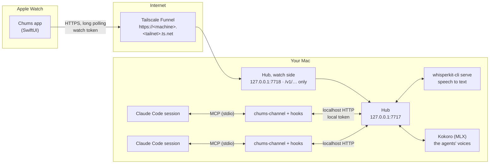

# How Chums works

Chums has four parts:

- **The watch app** (`app/ChumsWatch`, SwiftUI, watchOS 10 or later): draws the character, records your voice, shows
  approvals and replies, and polls the hub.
- **The iPhone app** (`app/ChumsPhone`, iOS 26): the same agents and conversations through the same hub, with
  widgets and a Talk control ([below](#the-iphone-app)).
- **The hub** (`hub/hub.mjs`, Node.js, on your Mac): the only thing that talks to the coding agents. It keeps track of
  sessions, routes what you say, holds approvals, transcribes speech and serves the watch API.
- **The channel and hooks** (`channel/`): connect each Claude Code session to the hub. `bin/chums-claude` starts a
  session with both. Codex CLI and GitHub Copilot CLI: see [other-agents.md](other-agents.md).

## Network

- watchOS does not support apps reaching a home-network address
  ([TN3135](https://developer.apple.com/documentation/technotes/tn3135-low-level-networking-on-watchos)); it works only
  when the iPhone happens to relay it. So the watch API goes on the internet through Tailscale Funnel
  (`bin/chums-tunnel`). The watch reaches it over whatever network it has: the iPhone, Wi-Fi or cellular.
- The public listener serves only `/v1/…`, on localhost, and only with the watch token. See [SECURITY.md](../SECURITY.md).
- The watch uses plain HTTP long polling. watchOS allows WebSockets only while streaming audio.
- The app's addresses are the public URL, then `http://127.0.0.1:7717`; it uses the first that answers. A real watch
  drops the local one, so only the Simulator falls back to it.
- `tailscaled` runs without admin rights (userspace networking), with its state in `~/.chums/tailscale`.

## Keyring mode

The watch can be carried on a keyring instead of worn. Keyring mode keeps Chums in front:

- It runs a workout session (HealthKit) so watchOS doesn't suspend the app when the screen dims. Without it nothing
  polls and nothing can tap your wrist. No workout is saved.
- If Chums quits during the session, watchOS relaunches it.
- When Chums isn't in front (after a crown press), approvals, questions, done and blocked arrive as local
  notifications; tapping one opens Chums. The complication / Smart Stack widget (`app/ChumsWidget`) opens it in one tap.

## Speech

You hold the screen to talk. The watch records the clip and posts it to the hub. The hub transcribes it with a
kept-alive `whisperkit-cli serve` (about 0.2 s per clip with the base model). Clips are padded with silence because
Whisper drops clips under 1 s. Replies are short (the channel refuses replies over 15 words to the watch and 60 to
the iPhone: each order carries the device it came from, `via="watch"` or `via="phone"`), and each agent speaks
them in its own voice (below).

## The agents' voices

Each agent speaks in its own voice: Kokoro (82M parameters, Apache-2.0) on the Mac's GPU through MLX
(`tools/kokoro-server.py`, installed by `bin/chums-setup` in `~/.chums/kokoro`). The hub starts it on
`127.0.0.1:50062` with every agent's voice loaded and warmed, and restarts it if it stops. Nothing leaves the Mac.

How a reply gets to the wrist fast:

- The hub renders a reply the moment the agent sends it: about 0.15 s for a sentence, AAC at 32 kbit/s, about 20 KB.
- After a quiet minute the chips slow down and a render takes about 0.45 s. A single word doesn't speed them up; a
  sentence every 2 s does. So while an agent works on an order from the watch, Kokoro renders a sentence nobody hears
  every 2 s, until the reply comes or for 45 s (about 5% of the GPU while you wait). Its threads also run at
  user-interactive priority.
- It holds the line until its audio is ready (never more than 1.5 s) and puts the audio in the same answer to the
  watch's long poll that carries the line (`audioData`, base64), so the watch plays it without a second request
  through Funnel. A line without inline audio is fetched from `/v1/speech/<id>`; without either, the watch reads it
  with its own voice.
- The hub's LaunchAgent is `Interactive`, so launchd doesn't throttle it, Whisper or Kokoro as background work.

The voices are Kokoro's English ones (`/v1/voices`); an agent's is `voice` in `agents.json`, chosen on the watch (its
soul screen, Voice, where each plays a sample). Other engines are a setting: `"tts": { "engine": "say", "voice":
"Ava (Premium)" }` for a macOS voice, `"openai"` with a key, or `"watch"` for the watch's own voice.

## The channel

`channel/chums-channel.mjs` is a Claude Code channel: an MCP server that Claude Code loads with
`--dangerously-load-development-channels server:chums` (channels are a research preview). One runs per session. It:

- registers the session with the hub and long-polls for orders, which arrive in the session as channel messages;
- relays permission requests to the hub and the verdicts back;
- gives the session two tools: `chums_reply` (speak one short sentence on the watch) and `chums_show` (show a picture).

`bin/chums-claude` writes `channel/mcp.json` and `channel/hooks.json` with this checkout's paths, keeps Remote Control
on, and lets the session call `chums_reply` and read `~/.chums/uploads` without asking (it may not edit
`~/.chums/souls`).

## Hooks and states

`bin/chums-claude` also installs Claude Code hooks (`channel/chums-hook.mjs`) for 15 events: tool calls and failures,
permission requests, notifications, prompts, stops and stop failures, compaction, subagents, session start and end.
The hub turns them into a status per session (`idle`, `working`, `waiting`, `blocked`, `limited`, `compacting`) and
reactions. [design/STATES.md](../design/STATES.md) maps every hook event and Agent Client Protocol update to a state,
a reaction, or nothing.

## Artifacts: pictures from a session

Ask from the watch to see something ("send me a screenshot of the desktop", "what does that page look like") and the
session calls `chums_show`:

- `screenshot: 'screen'` or an app's name (`'Safari'`): taken with `screencapture` from inside the session, so the app
  the session runs in needs Screen Recording permission. Pages behind a login are screenshots of the browser.
- `url`: a public page, rendered on the Mac by WebKit at phone width (`tools/page-shot.swift`, compiled to
  `~/.chums/bin/page-shot` on first use). The watch has no web engine, so pages arrive as pictures.
- `file`: a file of any kind below.

Every artifact is a picture for the watch (`kind` in its `meta.json`, which the apps label it by):

| What | `kind` | How it becomes a picture |
| --- | --- | --- |
| A URL, `.html`, `.htm` | `page` | WebKit at phone width, the whole page, once it has loaded and its animations have ended (`page-shot`, in a window in the screen's corner that can't be seen or clicked: WebKit runs a page's animations only on screen) |
| `.svg`, and images (`.png`, `.jpg`, `.heic`, `.gif`, `.webp`, `.tiff`, `.bmp`) | `image` | An SVG like a page; an image as it is |
| A screenshot | `screenshot` | As it is |
| `.pdf` | `pdf` | Every page, top to bottom, drawn by PDFKit (`tools/pdf-shot.swift`): 1200 px wide, narrower (down to 900 px) for more pages; past 10 M pixels the rest is left out and the title says which pages it shows ("pages 1–9 of 14") |
| `.md`, `.markdown` | `doc` | Made into a dark HTML page (`hub/render.mjs`: headings, lists, tables, code; links and images as their text), then WebKit |
| `.csv`, `.tsv` | `table` | The same: a table of the first rows (up to 200, the columns that fit in 1300 pt); the title says how many of how many |
| Code, logs, `.txt`, `.json` and any other UTF-8 text | `text` | The same: monospaced, the first lines that fit in one picture (up to 300); the title says "first 214 lines of 1,423" |
| `.mov`, `.mp4`, `.m4v` | `video` | A still from a second in (`ffmpeg`; without it, Quick Look's) |
| Anything else Quick Look has a picture of: Word, Excel, PowerPoint, Pages, Keynote, Numbers, RTF, EPUB, USDZ | `doc` | Quick Look's picture as Finder draws it, up to 1600 px (`tools/ql-shot.swift`): a document's first page, a presentation's first slide |

A file with none of these is refused with the reason. Each conversion has a time limit and runs in a process of its
own (the HTML pages too: `node hub/render.mjs`), so a large or odd file never holds up the hub. The pages the hub
makes load nothing: no links, images or scripts.

The hub keeps the last 60 in `~/.chums/artifacts/<id>/` (`full.jpg` up to 1200 px wide and 10 M pixels, `thumb.jpg`)
and serves them at `/v1/artifact/<id>/full|thumb`. On the watch a tap opens one full screen: the crown or a drag
scrolls, a double tap zooms, a drag down from the top or × closes it.

For the iPhone, which opens an artifact itself, the folder also keeps the file as it was (`source.<ext>`, up to 25 MB)
and, for Markdown, text and tables, the hub's HTML page of it (`view.html`, with more than the picture: up to 5,000
lines or 1,000 rows). `meta.view` says what there is, and comes with the artifact in `/v1/state`:

| `view.type` | For | `view.file` (what `/view` serves) |
| --- | --- | --- |
| `url` | A page shown by its URL (`view.url`; no file) | |
| `html` | `.html`, `.htm`, `.svg` (`source.<ext>`); Markdown, CSV and TSV (`view.html`) | `source.html`, `source.svg` or `view.html` |
| `pdf` | `.pdf` | `source.pdf` |
| `image` | Images and screenshots | `source.<ext>` |
| `text` | Code, logs and other text | `view.html` |
| `doc` | What Quick Look opens: Office, iWork, RTF, EPUB, USDZ | `source.<ext>` |
| `video` | `.mov`, `.mp4`, `.m4v` | `source.<ext>` |

`view` also has `name` (the file's name), `ext`, `size` (bytes) and `source` (whether the original was kept: not over
25 MB). `/v1/artifact/<id>/source` serves the original and `/v1/artifact/<id>/view` the file named in `view.file`,
each with its type and file name, and byte ranges (a video player asks for them). An HTML page is served sandboxed
(`Content-Security-Policy: sandbox allow-scripts`): its scripts run, in an origin of their own. Artifacts made before
`view` existed have none; the apps show their picture.

## Agents: one per character

Every character is its own agent: its own soul, its own session and thread, its own conversation on the watch. A
Claude Code agent (the default) is a session run in the background by a LaunchAgent (`bin/chums-agents install`; then
`status`, `stop|start|restart <id>`, and `open <id>` to take one into a terminal); a Codex agent runs inside the hub.
Which one is chosen per agent on the watch (its soul screen, Runs on) or on its card in the iPhone app: the hub
stops one and starts the other
(`POST /v1/agents/<id>/runtime`), and keeps each runtime's thread in `byRuntime` for a switch back.

They are listed in `~/.chums/agents.json`, one per character, the id the character's, which the hub writes with
defaults the first time and completes when a character has none ([tools/agents.example.json](../tools/agents.example.json)
shows the shape): each in `~/.chums/agents/<id>` with your home folder. Three get a job in their first soul: Noodle
code, Squint your Mac, Peeps design.

`tools/agent-host.exp` gives each session a terminal of its own and answers only the two start-up screens it knows
(trusting the agent's folder, confirming the development channel). `tools/agent-cmd.mjs` resumes the agent's thread,
adds its standing instructions and folders, and refuses to start a thread that is already running.

On the watch, the face at the top left is the agent you talk to, in front of up to two others (the most urgent
first). A tap opens the list of agents (amber: needs you, white: working, red: stuck, gray: idle, dimmed: not running)
with Settings below. Everything on screen, and everything you say, belongs to that agent. Another agent's news arrives
as a tap on the wrist and a pill with its face; a tap on the pill switches to that agent.

## Souls

Each agent's identity (its name, what it looks after, what it hands to the others, its voice) is its soul:
`~/.chums/souls/<id>.md`, in a git repository of its own. You change a soul by voice from the watch: swipe an agent in
the list, hold "Hold to change" and say what should be different. A separate, tool-free model call on the Mac
(`claude -p`, Sonnet, about 4 s) turns that into a targeted change and one sentence. You tap Save or Cancel; Undo goes
back one change. On the iPhone, a tap on a part of the soul on the agent's card edits it as text, saved as typed
(`POST /v1/agents/<id>/soul/set`) with no model call. An agent gets its current soul with the next order after a
change, and again after it compacts.

## The watch app

One screen, drawn every frame (SwiftUI `Canvas` in a `TimelineView`):

- `Rig/RigCore.swift`, `Rig.swift`, `Worlds.swift`: the shared rig (springs, blinks, gaze, states, camera, physics,
  crown, shaking) and the character kinds.
- `Rig/<Name>Stage.swift`: each character draws itself (Noodle, Stretch, Peeps, Squint, Ray, Tangle; Crunch and Nana
  in `Pix.swift`).
- `Controller.swift`: hub state to character state. `Screen.swift` (`ScreenModel`): gestures, motion, talking,
  approvals and replies, shared with the iPhone. `Voice.swift`: recording and speech. `ChumsWatchApp.swift`: the
  view, the crown, the overlays and Settings.
- Stretch plays Blender renders as HEIC image sequences (`app/ChumsWatch/Noodle/*.heics`, made by
  `tools/noodle-watch.sh`), decoded a frame at a time, since watchOS can't read frames out of video.

[characters.md](characters.md) covers how each character is made.

## The iPhone app

`app/ChumsPhone` uses the watch's engine: the characters (`Rig/`), the hub client, talking, the conversation and
`ScreenModel` (`Screen.swift`) are the same files, built for iOS (watch-only parts are `#if os(watchOS)`). With
`rig.chrome` off, the renderer draws only the character; the iPhone draws the rest in SwiftUI: the agents button and
panel, the conversation (with the character as its last row and its state lane beside it), the approval card, the
composer and the agent's card. It polls the hub only while it is open, so it sends no notifications.

Each device names itself to the hub (`X-Chums-Device` with a clip, `device` in `/v1/say`). An order remembers
the device it came from, and the agent's reply is tagged with it: every device shows the line, only that device
speaks it.

Photos and files from the iPhone go to `/v1/upload`, which keeps them in `~/.chums/uploads` and makes an artifact of
each, from you, as for `chums_show` (a file there is no picture of stays just a file). `/v1/say` then carries their paths in `files`: the order the agent
gets ends with "Attached (files on this Mac; read them): …", and the echo of what you said shows the picture.

The widgets (`app/ChumsPhoneWidgets`, views in `app/ChumsPhoneShared`) read `/v1/state` themselves with the same
address and token, draw the watch's screen for an agent with the watch's rig (`WatchScreen`: the character settles into
its state for 1.5 s, then one picture), answer approvals with `/v1/verdict` through an App Intent, and open the app
with `chums://agent/<id>` or `chums://talk/<id>`. An Agent widget with no agent picked shows the hub's `focus`: the
agent last talked to from any device, or the one the app shows (it posts `/v1/focus` when you change agents). The app
reloads the widgets when you change agents, when it goes to the background, and when the hub's state changes, at most
every 20 s. Debug builds draw every widget size to pictures with `-widgetShots YES`.

An agent's model, picked on its card in the app: `GET /v1/models` lists Claude Code's aliases and the models in Codex's
own cache (`~/.codex/models_cache.json`), with what each runtime uses by default; `POST /v1/agents/<id>/model` sets
`model` in agents.json and restarts the agent on it (`bin/chums-agents restart`, or its runner in the hub).

An agent's permission mode, picked on the watch and in the app: `GET /v1/permissions` lists each runtime's modes
(Claude Code: Asks first, Edits on its own, Decides on its own; Codex: Asks first, Asks when it needs to, Never asks),
with what each runtime uses when an agent has none (`permissions.defaultMode` in `~/.claude/settings.json`,
`approval_policy` in `~/.codex/config.toml`, else `on-request`); `POST /v1/agents/<id>/permission` sets
`permissionMode` (Claude Code, passed as `--permission-mode`) or `approvalPolicy` (Codex, on its thread) in agents.json
and restarts the agent in it, the same way. When auto mode refuses a step (Claude Code's `PermissionDenied` hook), the
agent's conversation gets a line of kind `refused`, "Auto mode refused: " and the step (at most one a minute per
agent), which the apps show and don't read aloud.
